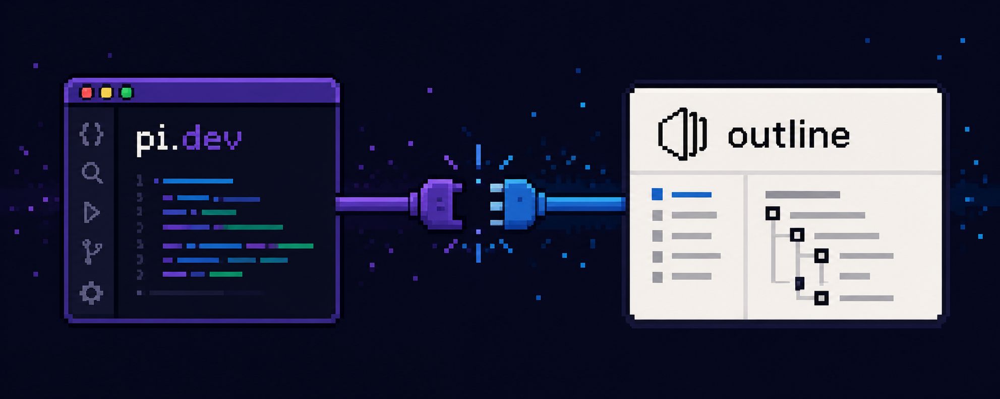

# pi-outline-wiki



Outline wiki extension for the [pi coding agent](https://github.com/earendil-works/pi).

Search, read, write, organise and comment on documents in your [Outline](https://www.getoutline.com/) knowledge base directly from your pi session. Credentials are stored locally in `~/.pi/outline-config.json`.

Works with Outline cloud (`yourteam.getoutline.com`) and with self-hosted installations.

## Installation

```bash
# Install from npm
pi install npm:@patimweb/pi-outline-wiki

# Install from local path during development
pi install /path/to/pi-outline-wiki
```

## Quick Start

1. In Outline, go to **Settings -> API & Apps** and create an API key (it starts with `ol_api_`).
2. Configure the workspace with the `outline_setup` tool.
3. Ask pi anything about your wiki, or use `/wiki <topic>`.

```
outline_setup:
  name: work
  url: https://acme.getoutline.com
  apiKey: ol_api_xxxxxxxxxxxxxxxxxxxxxxxxxxxxxxxxxxxxxx
  description: internal engineering wiki
```

`outline_setup` verifies the connection immediately and reports the workspace and the authenticated user, so a typo in the URL or key surfaces right away.

The `url` is forgiving: a bare host, a trailing slash, a pasted `/api` base or the `/mcp` endpoint from Outline's MCP docs are all normalised to the workspace root.

## Tools

| Tool | Description |
|------|-------------|
| `outline_setup` | Configure workspace URL and API key. Must be called first. |
| `outline_status` | Show configured profiles and verify the active key still works. |
| `outline_profile` | List, switch, or delete workspace profiles, with what each wiki holds. |
| `outline_collections` | List collections with their ids. |
| `outline_structure` | Show the nested document tree of one collection. |
| `outline_search` | Full-text search with optional collection, status and date filters; can search all workspaces at once. |
| `outline_list` | Browse documents: recent, by collection, by parent, or your drafts. |
| `outline_read` | Read a document's markdown body, optionally with children or saved to a file. |
| `outline_create` | Create a document in a collection or under a parent document. |
| `outline_update` | Replace, append to, or prepend to a document; rename it; publish a draft. |
| `outline_move` | Move a document into another collection or under another parent. |
| `outline_archive` | Archive, restore, or unpublish a document. |
| `outline_delete` | Move a document to the trash, or delete it permanently. |
| `outline_comments` | Read comment threads on a document, nested by reply. |
| `outline_comment` | Post a comment or reply on a document. |
| `outline_export` | Export a document or a whole collection to local markdown files. |

### Searching

`outline_search` runs Outline's full-text search and returns matching documents with a snippet and their ids. Read the full body with `outline_read`.

```yaml
outline_search:
  query: postgres failover
  # collectionId: <id>              # restrict to one collection
  # statusFilter: [published, archived]
  # dateFilter: month               # only recently updated documents
```

Archived documents are excluded unless you ask for them via `statusFilter`.

With several workspaces configured, `allProfiles: true` searches every one of them and labels each hit with the workspace it came from:

```yaml
outline_search:
  query: postgres failover
  allProfiles: true
```

`allProfiles` cannot be combined with `profile`, `collectionId` or `documentId` -- those are specific to a single workspace, and the tool rejects the combination rather than silently returning nothing.

### Reading

`outline_read` takes the document id (uuid) or the slug from an Outline URL. Long pages are truncated at 20,000 characters by default so a single wiki page cannot eat the whole context window.

```yaml
outline_read:
  id: deploy-runbook-aBc123XyZ
  # maxChars: 0                     # 0 = no truncation
  # includeChildren: true           # also list child documents
  # saveDir: ./docs                 # additionally write the full page to a .md file
```

### Writing

`outline_create` publishes into a collection by default. Pass `parentDocumentId` to nest a page, or `publish: false` to keep it as a personal draft.

```yaml
outline_create:
  title: Payment service failover
  collectionId: <id>
  text: |
    Summary of what this page is for.

    ## Steps
    1. ...
```

Do not repeat the title as a top-level heading in `text` -- Outline renders the title separately.

### Updating without losing content

`outline_update` defaults to `mode: replace`, which overwrites the whole body. Use `append` or `prepend` to add to a page without reading and re-sending it.

```yaml
# Add a dated entry to a decision log
outline_update:
  id: <id>
  mode: append
  text: |
    ## Switched to connection pooling - 2026-09-02
    ...
```

`mode: prepend` is the right choice for newest-first logs and for adding a notice at the top of a page.

### Retiring pages

`outline_archive` keeps a page searchable and restorable; it is the reversible option and should be preferred over deleting.

```yaml
outline_archive:
  id: <id>
  # action: archive | restore | unpublish
```

`outline_delete` moves a page to the trash (restore it with `outline_archive` action `restore`). `permanent: true` erases it and cannot be undone.

### Exporting into your repository

`outline_export` writes markdown files directly to disk, which is far cheaper than reading page after page through the model.

```yaml
outline_export:
  targetDir: ./docs/wiki
  collectionId: <id>        # or documentId: <id>
  # includeChildren: true   # with documentId
  # limit: 50
```

## Commands

| Command | Description |
|---------|-------------|
| `/wiki <topic>` | Search the wiki and summarise what it says, with citations. |
| `/wiki-capture [focus]` | Write the durable knowledge from this session into the wiki. |

## Skills

The package ships three skills that teach the agent how to use the wiki well, not just which tools exist:

| Skill | Purpose |
|-------|---------|
| `outline-wiki` | Research the wiki before answering questions about internal systems, conventions and decisions. |
| `outline-doc-writing` | Where a page belongs, how to structure it, and how to update it without destroying other people's work. |
| `outline-knowledge-capture` | Turn what was worked out in a session into a durable page: decision records, incident findings, gotchas. |

## Configuration

Credentials are persisted to `~/.pi/outline-config.json`, written atomically with mode `0600`. The `outline_setup` tool creates the file. You can also write it by hand:

```json
{
  "profiles": {
    "work": {
      "url": "https://acme.getoutline.com",
      "apiKey": "ol_api_xxxxxxxxxxxxxxxxxxxxxxxxxxxxxxxxxxxxxx"
    }
  },
  "activeProfile": "work"
}
```

### Multiple workspaces

Several Outline wikis can be configured side by side -- call `outline_setup` once per wiki with a different `name`. The first profile becomes active automatically; later ones do not steal the active slot.

```yaml
outline_setup:
  name: firma
  url: https://acme.getoutline.com
  apiKey: ol_api_xxx
  description: internal engineering wiki

outline_setup:
  name: kunde-a
  url: https://wiki.kunde-a.de
  apiKey: ol_api_yyy
  description: ACME client project docs
```

**Give every workspace a `description`.** It is shown by `outline_profile` and `outline_status`, and it is what lets the agent decide which wiki to search instead of guessing from a profile name. The bundled skills instruct the agent to check that list before searching, and to ask you rather than guess when a *write* could land in the wrong wiki.

| Need | How |
|------|-----|
| See what is configured | `outline_profile` |
| Switch the default | `outline_profile: { action: use, name: kunde-a }` |
| One call against another wiki | any tool + `profile: kunde-a` |
| Search everything at once | `outline_search` + `allProfiles: true` |

Document ids are scoped to their workspace. A hit that a fan-out search reports as `profile kunde-a` must be read with `outline_read` and `profile: kunde-a` -- the same id means nothing in another wiki.

If one workspace is unreachable or its key has expired, a fan-out search still returns the results from the others and reports the failure separately.

### Self-hosted instances

Point `url` at your installation, e.g. `https://wiki.example.com` or `http://localhost:3000`. If your instance uses a self-signed certificate, set `insecureTls: true` in `outline_setup`. This disables certificate validation for the whole pi process, so only use it when you have no alternative -- `outline_status` warns while it is active.

### Permissions

The extension acts as the user who owns the API key. It can only see and change what that user can see and change in Outline, so scoping access is a matter of which account the key belongs to.

## Development

```bash
npm install
npm test
npm run test:coverage
```

The code follows a data-oriented layout: plain immutable data in `src/types.ts`, all HTTP isolated in `src/clients/outline-client.ts`, pure display functions in `src/formatting/formatters.ts`, and one module per tool in `src/tools/`.

## License

MIT
